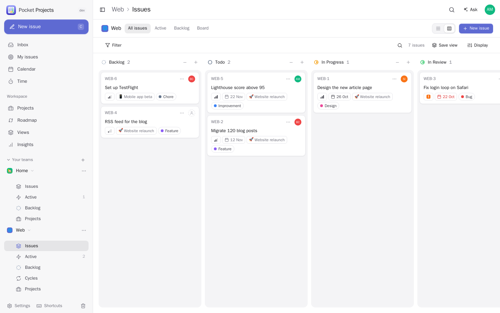
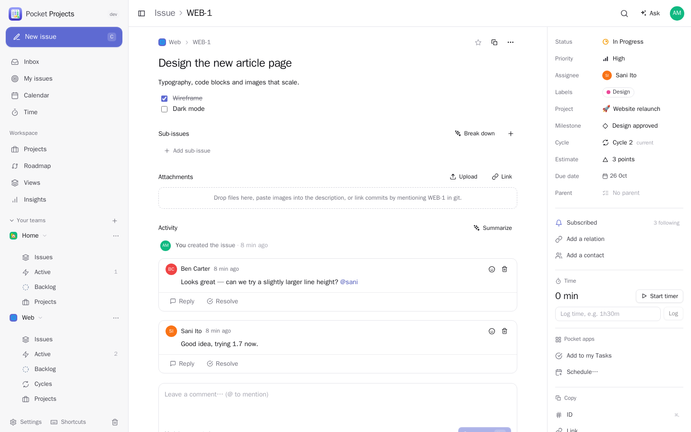
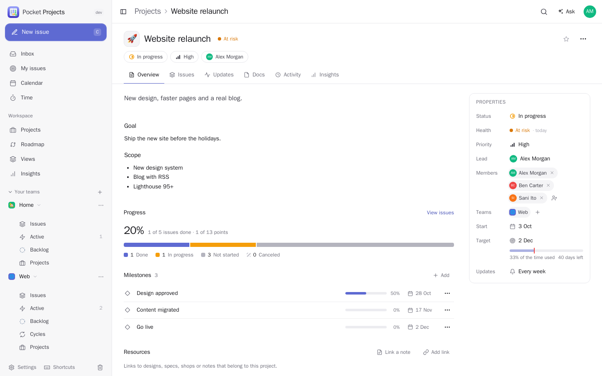
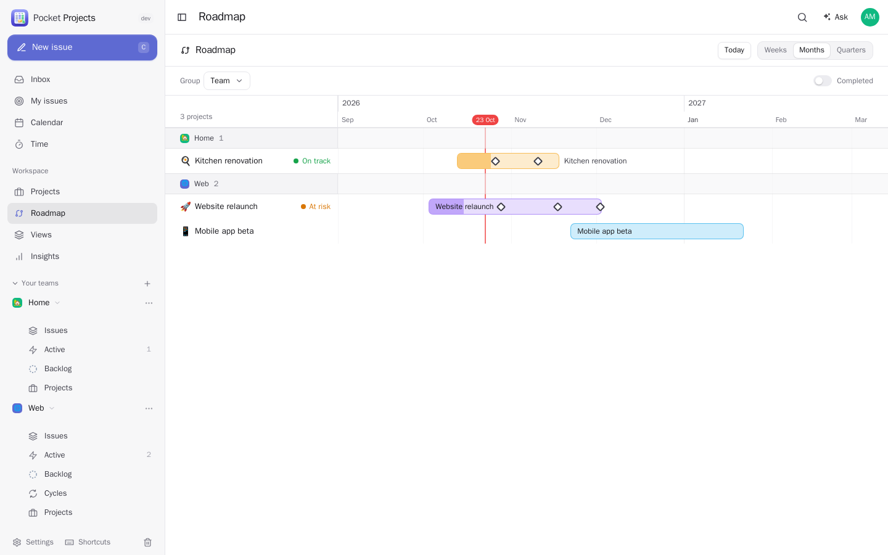
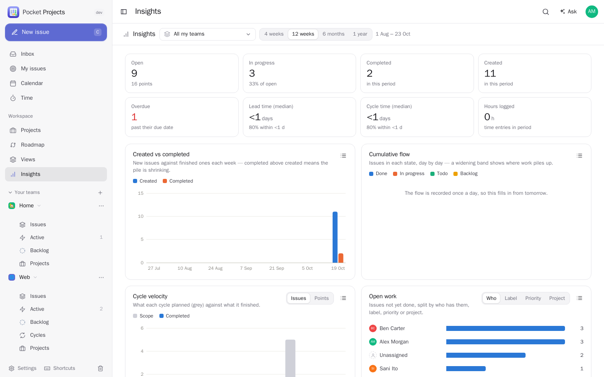
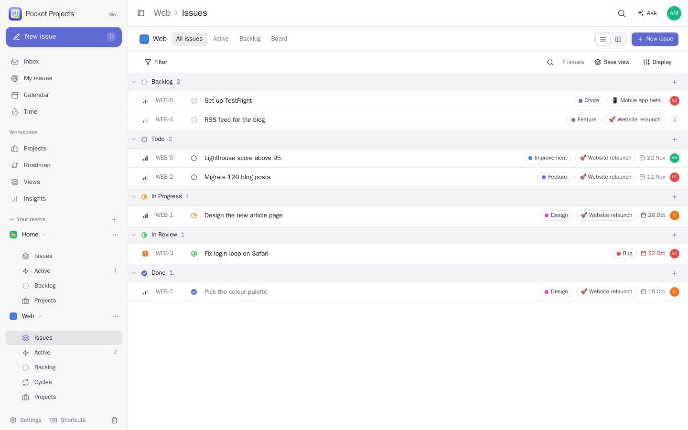
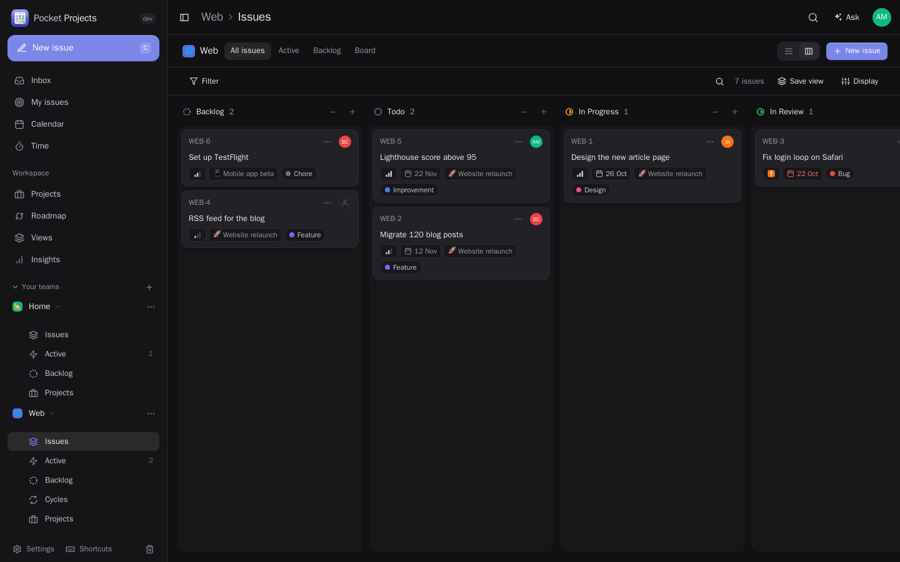
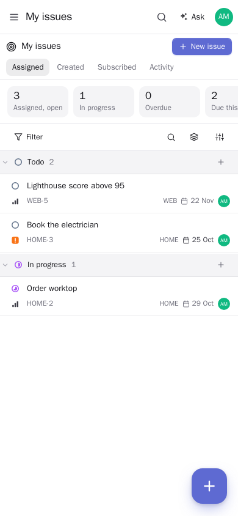
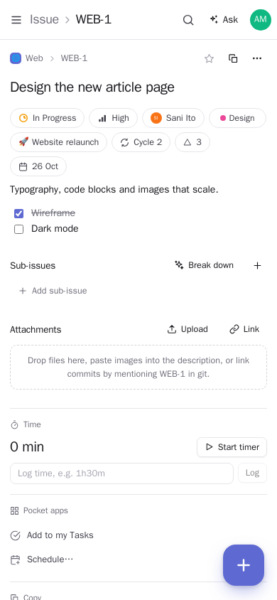

<p align="center"></p>
<h1 align="center">Pocket Projects</h1>
<p align="center">Self-hosted, Linear-style project tracking for a household or a small team: issues, a kanban board, projects with milestones and status updates, cycles and a roadmap — connected to your calendar, contacts, to-dos and Pocket AI.<br>One Go binary, one SQLite file, one volume.</p>

<p align="center"></p>

<table>
  <tr>
    <td width="50%"></td>
    <td width="50%"></td>
  </tr>
  <tr>
    <td align="center"><sub>Issues with every property one keystroke away.</sub></td>
    <td align="center"><sub>Projects with milestones, health and progress.</sub></td>
  </tr>
  <tr>
    <td width="50%"></td>
    <td width="50%"></td>
  </tr>
  <tr>
    <td align="center"><sub>A roadmap you can drag.</sub></td>
    <td align="center"><sub>Insights: flow, velocity, lead and cycle time.</sub></td>
  </tr>
  <tr>
    <td width="50%"></td>
    <td width="50%"></td>
  </tr>
  <tr>
    <td align="center"><sub>Lists grouped and filtered any way.</sub></td>
    <td align="center"><sub>Dark mode.</sub></td>
  </tr>
</table>

<p align="center">
  &nbsp;&nbsp;
  
</p>

## What it does

**Issues that move**
- Teams with their own workflow (Triage → Backlog → Todo → In Progress → In Review → Done), identifiers like
  `WEB-12` that keep working after a move, priorities, estimates (points or T-shirt sizes), due dates, labels with
  groups, sub-issues, relations (blocks, related, duplicate), people from your address book on an issue.
- A list grouped and sorted any way you like, and a **kanban board** with drag and drop (mouse and touch) and
  swimlanes. Filters for everything, saved as personal or team views. Bulk edits, keyboard shortcuts for all of it,
  ⌘K to find and do anything.
- Markdown descriptions and comments with @mentions, pasted images, threads, reactions; a full activity history;
  file and link attachments; time tracking with a timer and a timesheet export.
- Templates, and **repeating issues** (every Monday "check the backups", every month "pay the rent").

**Projects and planning**
- Projects across teams with a lead, members, start and target dates, milestones, documents, resources and
  stakeholders; **status updates** with health (on track / at risk / off track) and a nudge when one is due.
- **Cycles** (sprints) planned ahead automatically, unfinished work rolled over, burn-up charts.
- A **roadmap** timeline you can drag, a calendar of due dates and milestones next to your real calendar,
  **insights**: created vs completed, cumulative flow, velocity, lead and cycle time, workload.
- An **inbox** for assignments, mentions, comments, status changes and due dates — also pushed to your phone via
  Apprise, ntfy or a webhook.

**Connected** (through Pocket Core, as you)
- **Pocket Calendar**: schedule a meeting for an issue, project or milestone with the right people invited; the
  calendar shows your due dates, milestones and cycles.
- **Pocket Contacts**: stakeholders and clients from your address book; their contact page lists their projects.
- **Pocket Tasks**: put an issue on your personal to-do list; finishing the issue ticks it off.
- **Pocket Notes**: notes that link to a project, one click to write a new one.
- **Pocket AI**: write a description, break an issue into sub-issues, summarise a long thread, draft the weekly
  project update, suggest how to file an issue, turn meeting notes into issues — and every Pocket AI chat can read
  and change issues and projects through Core's tools (writes wait for your approval).
- **Code with Pocket AI**: from an issue, open a Claude Code or Codex conversation in the team's code folder
  (Investigate read-only, Fix it on the issue's branch, or Chat). Each team sets the folder, agent, model, effort,
  its own instructions (a system prompt) and a memory the agent adds to with your approval. After opening a pull
  request the agent links it to the issue, comments what changed and files follow-ups as sub-issues; lists and
  boards show a live mark while a conversation works, and each team has a "With AI" view.
- **Forgejo / GitHub**: commits and pull requests that mention `WEB-12` appear on the issue; `fixes WEB-12` closes it.
  With a team GitHub token, linked pull requests are checked every 5 minutes and a merge completes the issue.
- **Default assignee** per team: new issues go to the person creating them (or no one, or a chosen member).
- Outgoing webhooks (n8n…), a calendar feed for any calendar app, CSV import from Linear, Jira and GitHub, CSV and
  JSON export.

**Yours**
- Everything belongs to a team, and only its members see it — the box admin manages accounts, not other people's
  work. Members change things, guests read and comment.
- Sign in with a password or with Pocket Core; API tokens for scripts; everything has an API
  ([docs/api.md](docs/api.md)).

## Run it

```sh
docker run -d --name pocket-projects -p 8080:8080 -v ./data:/data \
  -e BASE_URL=https://projects.example.com ghcr.io/abjelosevic88/pocket-homelab-projects:latest
```

Open it, create the first account (you become the admin), create a team from a template (Software, Simple kanban,
Home & household, Client work, Personal goals) and press **C** for your first issue. `DEMO_DATA=true` fills an empty
box with two teams to play with. All settings: [docs/configuration.md](docs/configuration.md).

With [Pocket Core](https://github.com/abjelosevic88/pocket-homelab-core), add `CORE_URL` and `CORE_REGISTRATION_KEY`:
people sign in with Pocket Core, the household can be added to teams, and the Pocket app links switch on
([docs/integrations.md](docs/integrations.md)).

## Build

```sh
make all        # web UI + binary
make dev        # API on :8080 + Vite on :5173 with demo data
make test       # Go tests + type check
```

Design notes: [docs/design.md](docs/design.md).

## License

MIT
